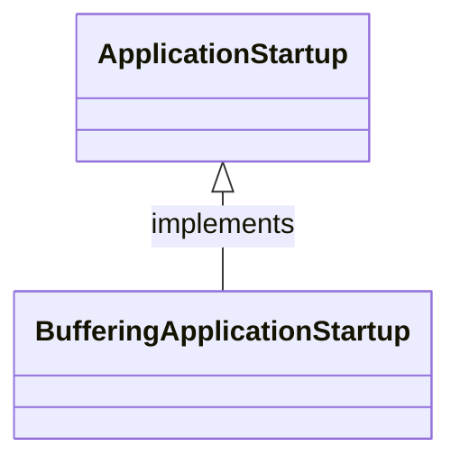

BufferingApplicationStartup

# 1. BufferingApplicationStartup 是什么？

先来看一下官方的doc
```bash
Instruments the application startup phase using steps.
The core container and its infrastructure components can use the ApplicationStartup to mark steps during the application startup and collect data about the execution context or their processing time.
```
简单来说：BufferingApplicationStartup是为了统计系统耗时开销



# 2.使用示例
```java
// SpringApplicationRunListeners.java
private void doWithListeners(String stepName, Consumer<SpringApplicationRunListener> listenerAction,
			Consumer<StartupStep> stepAction) {
		StartupStep step = this.applicationStartup.start(stepName);
		this.listeners.forEach(listenerAction);
		if (stepAction != null) {
			stepAction.accept(step);
		}
		step.end();
	}
```
获取时间分布
```bash
private void profileStartUp(){
        if(context instanceof ConfigurableApplicationContext configurableApplicationContext){
            ApplicationStartup startup = configurableApplicationContext.getApplicationStartup();
            if (startup instanceof BufferingApplicationStartup bufferingApplicationStartup) {
                bufferingApplicationStartup.getBufferedTimeline().getEvents().forEach(item -> {
                    item.getStartupStep().getTags().forEach(tag -> LOGGER.info("tag,{}={}",tag.getKey(),tag.getValue()));
                    LOGGER.info("{} cost {} ms", item.getStartupStep().getName(), item.getDuration().toMillis());
                });
            }
        }
    }
```
输出内容
```bash
tag,beanName=webEndpointServletHandlerMapping
spring.beans.instantiate cost 14 ms
tag,beanName=controllerEndpointHandlerMapping
spring.beans.instantiate cost 3 ms
```

# 3. 实现原理
如果系统没有多线程，那么系统的时间开销是线性的，而且函数调用时压栈的，每次函数调用新建一个栈，然后结束后销毁栈

时间开销就如下所示

```bash
------------------------------------------
| | |   |
|-| |   |
    |---|


```
## 3.1 start
```java

    @Override
	public StartupStep start(String name) {
		int id = this.idSeq.getAndIncrement();
		Instant start = this.clock.instant();
		while (true) {
			BufferedStartupStep current = this.current.get();
			BufferedStartupStep parent = getLatestActive(current);
			BufferedStartupStep next = new BufferedStartupStep(parent, name, id, start, this::record);
			if (this.current.compareAndSet(current, next)) {
				return next;
			}
		}
	}

    private void record(BufferedStartupStep step) {
        
		if (this.filter.test(step) && this.estimatedSize.get() < this.capacity) {
			this.estimatedSize.incrementAndGet();
            //// 每次 step调用 end，就会将 step加入到 队列中
			this.events.add(new TimelineEvent(step, this.clock.instant()));
		}
		while (true) {
			BufferedStartupStep current = this.current.get();
			BufferedStartupStep next = getLatestActive(current);
			if (this.current.compareAndSet(current, next)) {
				return;
			}
		}
	}
```

## 3.2 end
```java
    @Override
	public void end() {
		this.ended.set(true);
		this.recorder.accept(this);
	}
```

## 3.3 getBufferedTimeline
```bash
public StartupTimeline getBufferedTimeline() {
		return new StartupTimeline(this.startTime, new ArrayList<>(this.events));
	}
```


# 4. 总结
BufferingApplicationStartup  是 Spring 5.3/Spring Boot 2.4 引入的一把性能分析利器：

低侵入、低开销：专门为微服务启动调优设计，平时关闭时零负担。

精准定位：告别盲目猜测，精确到毫秒和具体的 Bean 名称，告诉你到底是谁拖慢了系统的启动。